# Bug Report – EShop (Võ Thành Minh Tuệ – 23120398)

Phạm vi: Đăng ký (FR-01), Đăng nhập (FR-02), Quên mật khẩu (FR-03), Hồ sơ (FR-04) trên `frontend-web` (`localhost:5173`).
Nguồn: 61 mục Failed của `checklist.xlsx`, gom thành **45 bug** (một bug có thể ứng với nhiều mục). BUG-23 là phát hiện từ đọc mã + gọi API, không có mục checklist UI tương ứng.
Môi trường: Windows 11, Chromium 156 (Playwright) và Chrome thật; DB reset bằng `node database.js` trước mỗi lượt.

| Mức độ | Số bug |
|---|---|
| Rất cao | 2 |
| Cao | 14 |
| Trung bình | 13 |
| Thấp | 16 |

| Bug | Mức | Tiêu đề | Mục checklist | Issue GitHub |
|---|---|---|---|---|
| BUG-01 | Cao | [Đăng ký] Mật khẩu hợp lệ "Test1234!" bị từ chối, regex đòi khoảng trắng và cấm ký tự đặc biệt | IA02-06, IA02-08 | _(chưa tạo)_ |
| BUG-02 | Cao | [Đăng ký] Thiếu trường Xác nhận mật khẩu | IA02-09 | _(chưa tạo)_ |
| BUG-03 | Cao | [Đăng ký/API] Backend không validate email và mật khẩu | IA02-04 | _(chưa tạo)_ |
| BUG-04 | Cao | [Đăng ký/API] Email trùng vẫn đăng ký được | IA02-05 | _(chưa tạo)_ |
| BUG-05 | Trung bình | [Đăng ký/Đăng nhập/Quên MK] Ô email dùng type="text" thay vì type="email" | IA02-03 | _(chưa tạo)_ |
| BUG-06 | Trung bình | [Đăng nhập] Tiêu đề trang ghi "Đăng Ký" thay vì "Đăng Nhập" | IA01-02 | _(chưa tạo)_ |
| BUG-07 | Thấp | [Đăng nhập] Nhãn "Username" và nút "Sign In" bằng tiếng Anh, sai ngữ nghĩa (hệ thống dùng email) | IA01-01, IA01-03 | _(chưa tạo)_ |
| BUG-08 | Cao | [Đăng nhập] Ô mật khẩu hiển thị chữ rõ (type="text") | IA02-11 | _(chưa tạo)_ |
| BUG-09 | Cao | [Đăng nhập] Tài khoản bị khóa sau 2 lần sai thay vì 3 (bộ đếm tăng +2/lần) | IA04-04 | _(chưa tạo)_ |
| BUG-10 | Cao | [Đăng nhập] Thời gian khóa 180 giây thay vì 30 giây | IA04-04, IA04-05 | _(chưa tạo)_ |
| BUG-11 | Rất cao | [Đăng nhập/API] Phản hồi trả về mật khẩu plaintext của user | ADD-14 | _(chưa tạo)_ |
| BUG-12 | Trung bình | [Đăng nhập] Thứ tự Tab sai do tabIndex=1 trên nút Sign In | IA03-11, ADD-09 | _(chưa tạo)_ |
| BUG-13 | Thấp | [Đăng nhập] Link "Quên mật khẩu?" tải lại cả trang | IA03-02 | _(chưa tạo)_ |
| BUG-14 | Cao | [Quên MK] OTP chỉ 4 chữ số thay vì 6 | IA02-18 | _(chưa tạo)_ |
| BUG-15 | Trung bình | [Quên MK] Không có chỉ báo bước (Bước 1/2) | IA04-09 | _(chưa tạo)_ |
| BUG-16 | Trung bình | [Quên MK] Không có nút Quay lại đăng nhập | IA03-03 | _(chưa tạo)_ |
| BUG-17 | Cao | [Quên MK] Bước 2 thiếu ô Xác nhận mật khẩu mới | IA02-09 | _(chưa tạo)_ |
| BUG-18 | Trung bình | [Quên MK/Hồ sơ] Dùng alert() cho lỗi/thành công, không hiển thị inline | IA04-08, IA04-10, IA04-11, IA04-12 | _(chưa tạo)_ |
| BUG-19 | Thấp | [Quên MK] Nút "← Quay lại" cùng màu xanh lá với nút "Đặt lại mật khẩu" | IA01-08 | _(chưa tạo)_ |
| BUG-20 | Cao | [Quên MK] Mật khẩu mới hợp lệ bị từ chối (cùng regex lỗi BUG-01) và backend chấp nhận mật khẩu yếu | IA02-08, ADD-15 | _(chưa tạo)_ |
| BUG-21 | Trung bình | [Quên MK/API] Lộ việc email có tồn tại (user enumeration) | IA04-08 | _(chưa tạo)_ |
| BUG-22 | Cao | [Hồ sơ] Số điện thoại 0912345678 bị từ chối (regex sai) | IA02-13, IA02-14, IA02-15 | _(chưa tạo)_ |
| BUG-23 | Rất cao | [Hồ sơ/API] User tự nâng quyền role=admin | — | _(chưa tạo)_ |
| BUG-24 | Cao | [Header/Hồ sơ] XSS qua Họ tên (dangerouslySetInnerHTML) | ADD-13 | _(chưa tạo)_ |
| BUG-25 | Thấp | [Hồ sơ] Chưa đăng nhập: chỉ hiện chữ "Vui lòng đăng nhập", không chuyển hướng/không có link | IA03-07 | _(chưa tạo)_ |
| BUG-26 | Trung bình | [Tất cả form] Không có trạng thái loading, nút không bị vô hiệu khi gửi | IA02-20, IA04-07 | _(chưa tạo)_ |
| BUG-27 | Cao | [Tất cả form] Nhãn không gắn với ô nhập (không có for/id/aria-label) | IA02-01, ADD-01 | _(chưa tạo)_ |
| BUG-28 | Trung bình | [Toàn site] <html lang="en">, title chung "frontend-web", không có <h1> ở các màn | IA01-15, ADD-02, ADD-03, ADD-04 | _(chưa tạo)_ |
| BUG-29 | Trung bình | [Tất cả form] Lỗi không được thông báo cho trình đọc màn hình (không có aria-live/role=alert) | ADD-11 | _(chưa tạo)_ |
| BUG-30 | Trung bình | [Toàn site] Tương phản màu không đạt WCAG AA (hint 2.54:1, link xanh 3.68:1, nút đỏ 3.76:1, nút xanh lá 3.3:1) | IA01-04, IA01-05, ADD-05 | _(chưa tạo)_ |
| BUG-31 | Trung bình | [Toàn site] Đường dẫn không tồn tại hiển thị trang trắng, không có 404 | ADD-12 | _(chưa tạo)_ |
| BUG-32 | Thấp | [Giao diện] Nút chính không nhất quán: Đăng ký màu đỏ, các màn khác màu xanh dương/xanh lá | IA01-07 | _(chưa tạo)_ |
| BUG-33 | Thấp | [Đăng ký] Đăng ký xong chuyển thẳng /login, không có thông báo thành công | IA03-05, IA04-01 | _(chưa tạo)_ |
| BUG-34 | Thấp | [Form] Thiếu thuộc tính autocomplete (email, current-password, new-password) và không có nút hiện/ẩn mật khẩu | IA02-10, ADD-10 | _(chưa tạo)_ |
| BUG-35 | Trung bình | [Hồ sơ] Header không cập nhật họ tên sau khi sửa hồ sơ | ADD-16 | _(chưa tạo)_ |
| BUG-36 | Thấp | [Hồ sơ] Trang Hồ sơ cuộn ngang ở màn 375px (bảng đơn hàng tràn) | IA01-10, IA01-11 | _(chưa tạo)_ |
| BUG-37 | Thấp | [Hồ sơ] Ngày và tiền trong lịch sử đơn không theo định dạng Việt Nam | IA01-14 | _(chưa tạo)_ |
| BUG-38 | Thấp | [Đăng nhập/Đăng ký] Đã đăng nhập vẫn mở được /login và /register | IA03-08 | _(chưa tạo)_ |
| BUG-39 | Thấp | [Quên MK] Tải lại trang ở bước 2 mất trạng thái, quay về bước 1 mà không báo | IA03-10 | _(chưa tạo)_ |
| BUG-40 | Cao | [Hồ sơ] Nút "Hủy đơn" vẫn hiện với đơn đang giao và hủy không cần xác nhận | IA04-14 | _(chưa tạo)_ |
| BUG-41 | Thấp | [Hồ sơ] Lịch sử đơn không có trạng thái đang tải | IA04-13 | _(chưa tạo)_ |
| BUG-42 | Thấp | [Đăng ký/Hồ sơ] Họ tên không cắt khoảng trắng, không giới hạn độ dài | IA02-12 | _(chưa tạo)_ |
| BUG-43 | Thấp | [Đăng ký] Không đánh dấu trường bắt buộc | IA02-02 | _(chưa tạo)_ |
| BUG-44 | Thấp | [Đăng ký] Thông báo lỗi mật khẩu không nêu điều kiện còn thiếu | IA02-07 | _(chưa tạo)_ |
| BUG-45 | Thấp | [Giao diện] Khoảng cách và trạng thái hover không nhất quán giữa các màn | IA01-06, IA01-12 | _(chưa tạo)_ |

## BUG-01 – [Đăng ký] Mật khẩu hợp lệ "Test1234!" bị từ chối, regex đòi khoảng trắng và cấm ký tự đặc biệt

- **Mức độ:** Cao
- **Mục checklist:** IA02-06, IA02-08
- **Bước tái hiện:** Mở /register → nhập Họ tên, email, mật khẩu `Test1234!` → Đăng Ký
- **Kỳ vọng:** Chấp nhận (FR-01: ≥8 ký tự, hoa, thường, số, ký tự đặc biệt @$!%*?&)
- **Thực tế:** Hiện lỗi "Mật khẩu quá yếu…". Mật khẩu `Test 1234` (có khoảng trắng, không ký tự đặc biệt) lại được chấp nhận
- **Ảnh:** 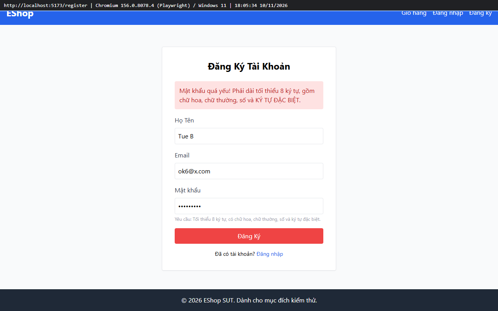
- **GitHub Issue:** _(chưa tạo)_

## BUG-02 – [Đăng ký] Thiếu trường Xác nhận mật khẩu

- **Mức độ:** Cao
- **Mục checklist:** IA02-09
- **Bước tái hiện:** Mở /register
- **Kỳ vọng:** Có ô Xác nhận mật khẩu, từ chối nếu không khớp (FR-01)
- **Thực tế:** Form chỉ có Họ tên, Email, Mật khẩu
- **Ảnh:** 
- **GitHub Issue:** _(chưa tạo)_

## BUG-03 – [Đăng ký/API] Backend không validate email và mật khẩu

- **Mức độ:** Cao
- **Mục checklist:** IA02-04
- **Bước tái hiện:** `POST /api/register {"name":"x","email":"notanemail","password":"1"}`
- **Kỳ vọng:** 400 + thông báo lỗi
- **Thực tế:** 200 "User registered successfully"
- **Ảnh:**  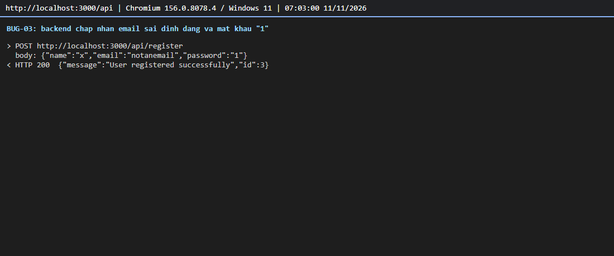
- **GitHub Issue:** _(chưa tạo)_

## BUG-04 – [Đăng ký/API] Email trùng vẫn đăng ký được

- **Mức độ:** Cao
- **Mục checklist:** IA02-05
- **Bước tái hiện:** `POST /api/register` với email `test@eshop.com` đã tồn tại
- **Kỳ vọng:** Từ chối: email phải duy nhất (FR-01)
- **Thực tế:** 200, tạo thêm user mới (id 4)
- **Ảnh:** 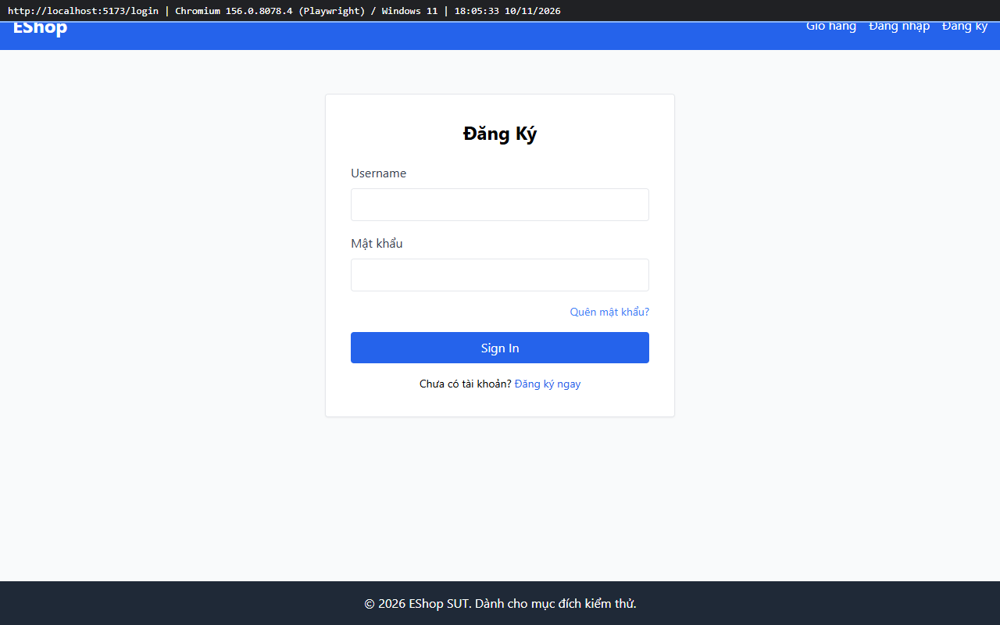 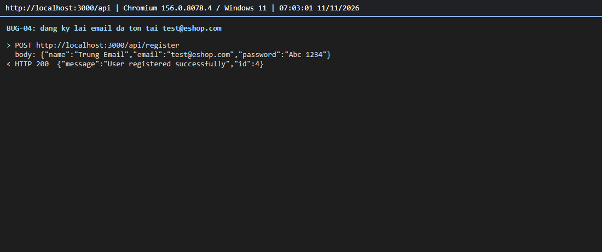
- **GitHub Issue:** _(chưa tạo)_

## BUG-05 – [Đăng ký/Đăng nhập/Quên MK] Ô email dùng type="text" thay vì type="email"

- **Mức độ:** Trung bình
- **Mục checklist:** IA02-03
- **Bước tái hiện:** Mở 3 màn, nhập `abc` vào ô email → submit
- **Kỳ vọng:** Trình duyệt chặn bằng validate HTML5 (FR-02)
- **Thực tế:** Không có validate định dạng phía trình duyệt
- **Ảnh:** 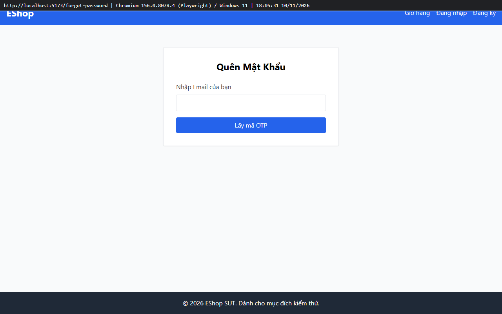
- **GitHub Issue:** _(chưa tạo)_

## BUG-06 – [Đăng nhập] Tiêu đề trang ghi "Đăng Ký" thay vì "Đăng Nhập"

- **Mức độ:** Trung bình
- **Mục checklist:** IA01-02
- **Bước tái hiện:** Mở /login
- **Kỳ vọng:** Tiêu đề "Đăng Nhập"
- **Thực tế:** Tiêu đề là "Đăng Ký"
- **Ảnh:** 
- **GitHub Issue:** _(chưa tạo)_

## BUG-07 – [Đăng nhập] Nhãn "Username" và nút "Sign In" bằng tiếng Anh, sai ngữ nghĩa (hệ thống dùng email)

- **Mức độ:** Thấp
- **Mục checklist:** IA01-01, IA01-03
- **Bước tái hiện:** Mở /login
- **Kỳ vọng:** Nhãn "Email", nút "Đăng nhập" (đồng bộ tiếng Việt)
- **Thực tế:** Nhãn "Username", nút "Sign In"
- **Ảnh:** 
- **GitHub Issue:** _(chưa tạo)_

## BUG-08 – [Đăng nhập] Ô mật khẩu hiển thị chữ rõ (type="text")

- **Mức độ:** Cao
- **Mục checklist:** IA02-11
- **Bước tái hiện:** Mở /login → gõ vào ô Mật khẩu
- **Kỳ vọng:** Ký tự bị che (type="password")
- **Thực tế:** Mật khẩu hiện nguyên văn
- **Ảnh:** 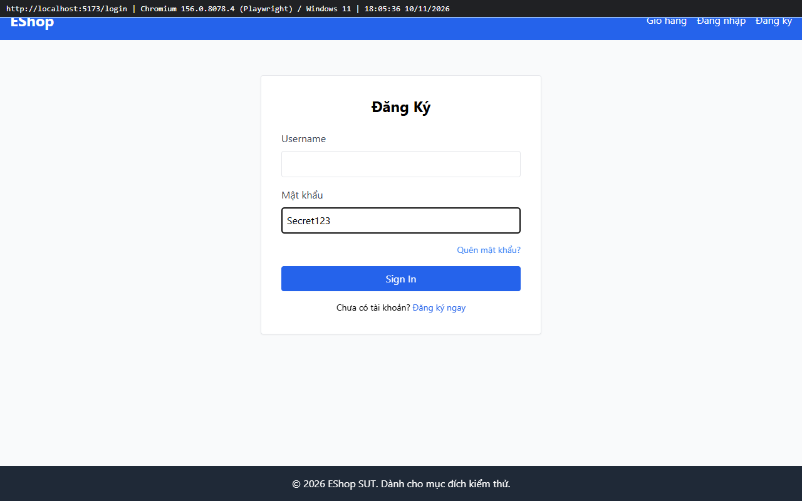
- **GitHub Issue:** _(chưa tạo)_

## BUG-09 – [Đăng nhập] Tài khoản bị khóa sau 2 lần sai thay vì 3 (bộ đếm tăng +2/lần)

- **Mức độ:** Cao
- **Mục checklist:** IA04-04
- **Bước tái hiện:** Đăng nhập sai 2 lần liên tiếp với test@eshop.com rồi đăng nhập đúng
- **Kỳ vọng:** Mỗi lần sai +1; khóa từ lần sai thứ 3 (FR-02)
- **Thực tế:** Sai lần 2 đã khóa (login_attempts=4); đăng nhập đúng bị 403 "Tài khoản đã bị khóa"
- **Ảnh:** 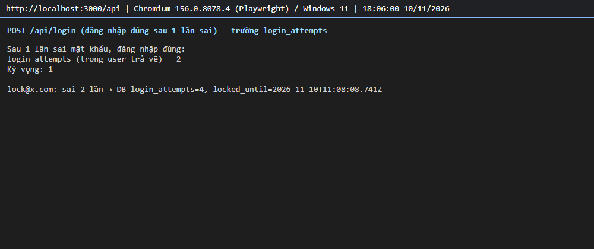
- **GitHub Issue:** _(chưa tạo)_

## BUG-10 – [Đăng nhập] Thời gian khóa 180 giây thay vì 30 giây

- **Mức độ:** Cao
- **Mục checklist:** IA04-04, IA04-05
- **Bước tái hiện:** Làm khóa tài khoản, đọc `locked_until`
- **Kỳ vọng:** Khóa 30 giây (FR-02)
- **Thực tế:** Khóa 180 giây (đo được 180s)
- **Ảnh:** 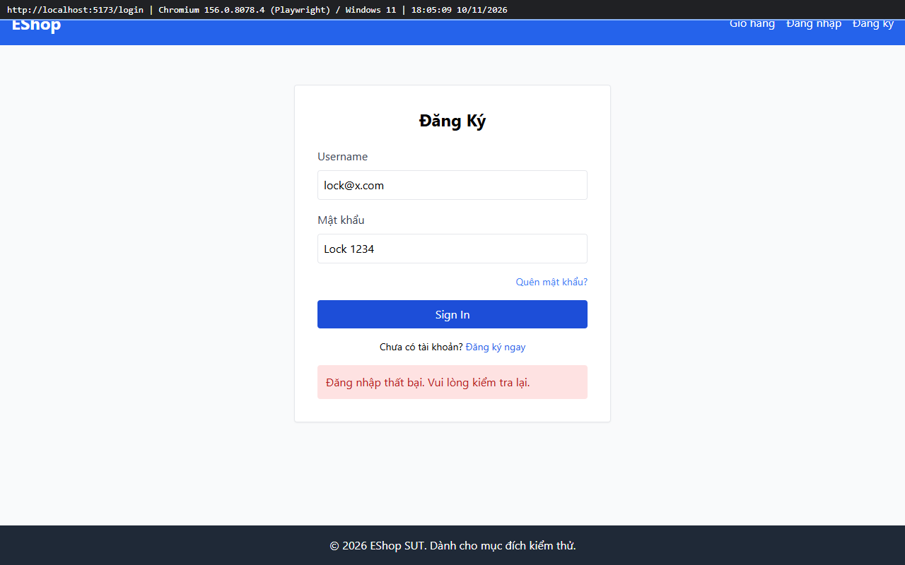
- **GitHub Issue:** _(chưa tạo)_

## BUG-11 – [Đăng nhập/API] Phản hồi trả về mật khẩu plaintext của user

- **Mức độ:** Rất cao
- **Mục checklist:** ADD-14
- **Bước tái hiện:** `POST /api/login` đúng thông tin, hoặc `GET /api/users/me`
- **Kỳ vọng:** Không trả trường password
- **Thực tế:** Body chứa `"password":"Test1234!"`
- **Ảnh:** 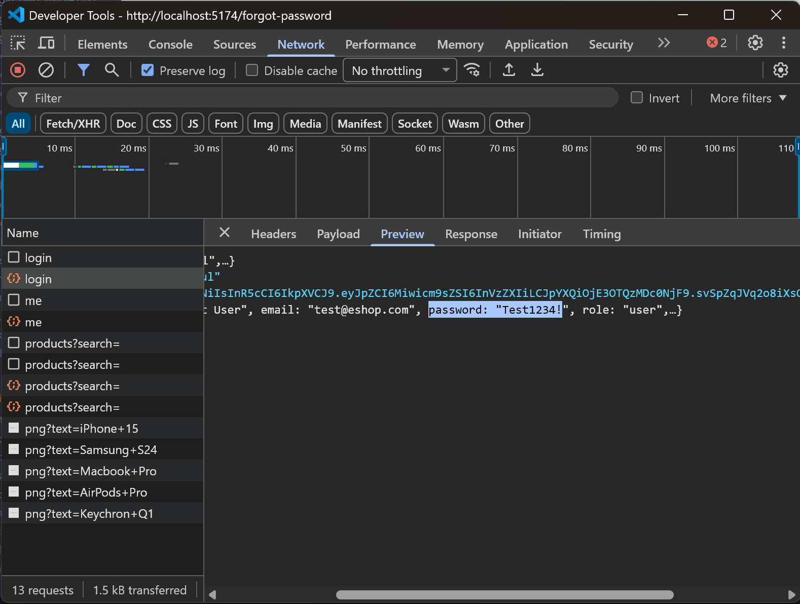 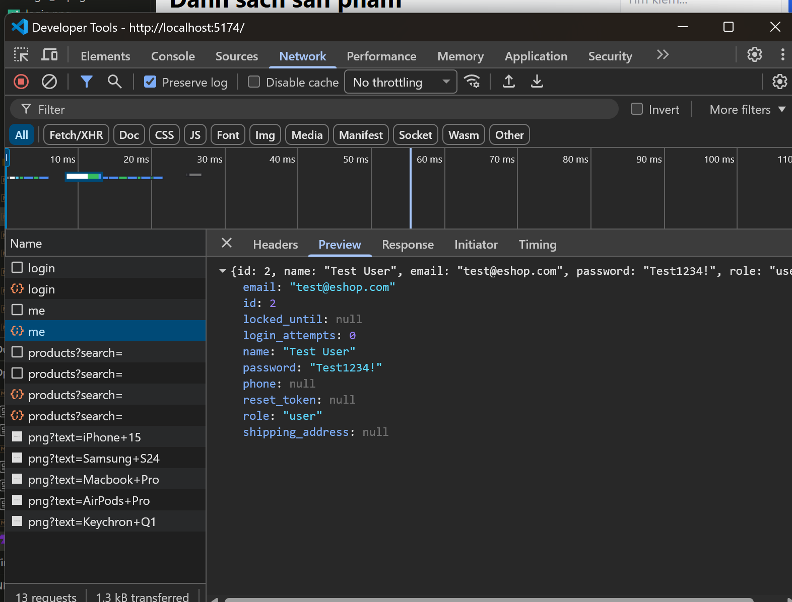
- **GitHub Issue:** _(chưa tạo)_

## BUG-12 – [Đăng nhập] Thứ tự Tab sai do tabIndex=1 trên nút Sign In

- **Mức độ:** Trung bình
- **Mục checklist:** IA03-11, ADD-09
- **Bước tái hiện:** Mở /login, nhấn Tab
- **Kỳ vọng:** Tab đi theo thứ tự hiển thị (email → mật khẩu → quên MK → nút)
- **Thực tế:** Tab đầu tiên nhảy vào nút "Sign In", rồi tới logo/menu
- **Ảnh:** 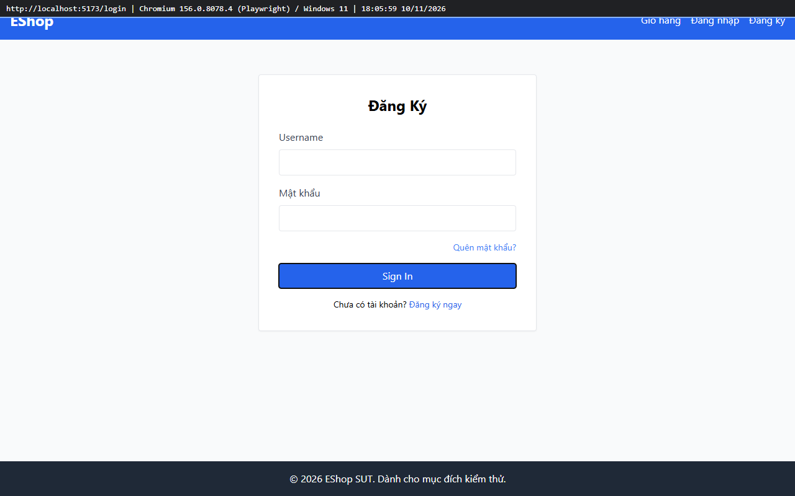
- **GitHub Issue:** _(chưa tạo)_

## BUG-13 – [Đăng nhập] Link "Quên mật khẩu?" tải lại cả trang

- **Mức độ:** Thấp
- **Mục checklist:** IA03-02
- **Bước tái hiện:** Mở /login → bấm "Quên mật khẩu?"
- **Kỳ vọng:** Điều hướng SPA (không reload)
- **Thực tế:** Reload toàn trang (dùng <a href>)
- **Ảnh:** 
- **GitHub Issue:** _(chưa tạo)_

## BUG-14 – [Quên MK] OTP chỉ 4 chữ số thay vì 6

- **Mức độ:** Cao
- **Mục checklist:** IA02-18
- **Bước tái hiện:** Bước 1 nhập test@eshop.com → Lấy mã OTP
- **Kỳ vọng:** OTP 6 chữ số (FR-03)
- **Thực tế:** OTP 4 chữ số (vd 9750), nhãn "Mã OTP (4 số)"
- **Ảnh:** 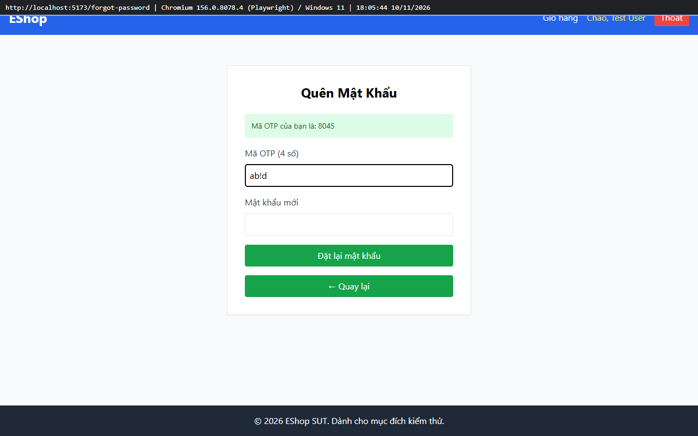
- **GitHub Issue:** _(chưa tạo)_

## BUG-15 – [Quên MK] Không có chỉ báo bước (Bước 1/2)

- **Mức độ:** Trung bình
- **Mục checklist:** IA04-09
- **Bước tái hiện:** Mở /forgot-password
- **Kỳ vọng:** Hiện "Bước 1 / 2" (FR-03)
- **Thực tế:** Không có chỉ báo
- **Ảnh:** 
- **GitHub Issue:** _(chưa tạo)_

## BUG-16 – [Quên MK] Không có nút Quay lại đăng nhập

- **Mức độ:** Trung bình
- **Mục checklist:** IA03-03
- **Bước tái hiện:** Mở /forgot-password (bước 1 và 2)
- **Kỳ vọng:** Có nút "Quay lại đăng nhập" (FR-03)
- **Thực tế:** Bước 1 không có; bước 2 chỉ có "← Quay lại" về bước 1
- **Ảnh:** 
- **GitHub Issue:** _(chưa tạo)_

## BUG-17 – [Quên MK] Bước 2 thiếu ô Xác nhận mật khẩu mới

- **Mức độ:** Cao
- **Mục checklist:** IA02-09
- **Bước tái hiện:** Qua bước 2
- **Kỳ vọng:** Có ô Xác nhận mật khẩu mới (FR-03)
- **Thực tế:** Chỉ có OTP + Mật khẩu mới
- **Ảnh:** 
- **GitHub Issue:** _(chưa tạo)_

## BUG-18 – [Quên MK/Hồ sơ] Dùng alert() cho lỗi/thành công, không hiển thị inline

- **Mức độ:** Trung bình
- **Mục checklist:** IA04-08, IA04-10, IA04-11, IA04-12
- **Bước tái hiện:** Nhập email không tồn tại ở bước 1; cập nhật hồ sơ
- **Kỳ vọng:** Thông báo inline, có thể đọc lại, gắn với ô nhập
- **Thực tế:** Hộp thoại alert() chặn thao tác ("Lỗi: User not found", "Cập nhật thành công!")
- **Ảnh:** 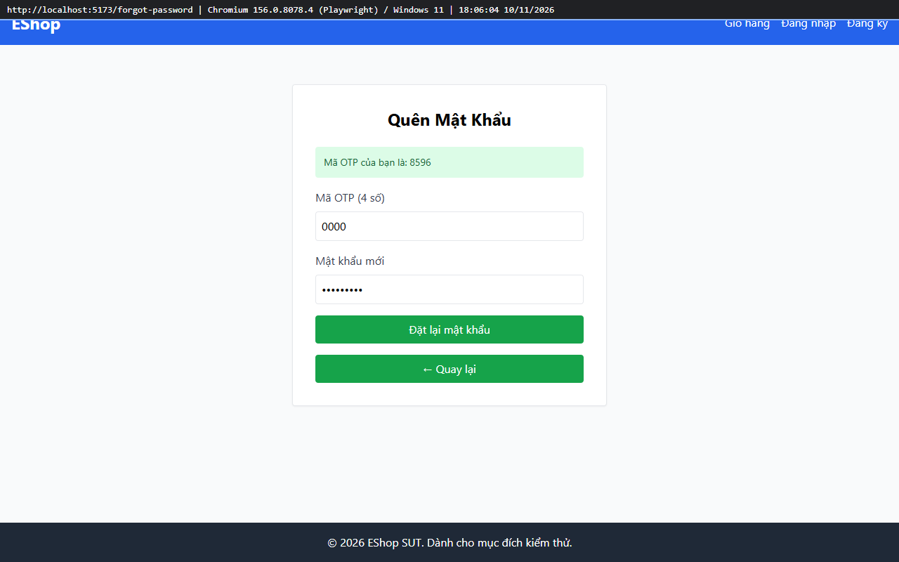 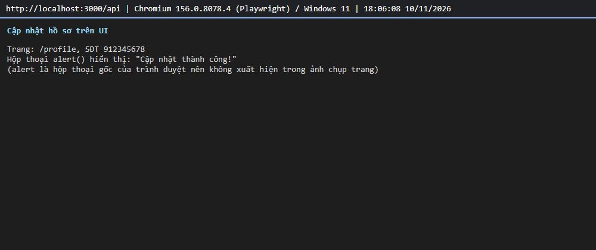
- **GitHub Issue:** _(chưa tạo)_

## BUG-19 – [Quên MK] Nút "← Quay lại" cùng màu xanh lá với nút "Đặt lại mật khẩu"

- **Mức độ:** Thấp
- **Mục checklist:** IA01-08
- **Bước tái hiện:** Qua bước 2
- **Kỳ vọng:** Nút phụ khác kiểu nút chính
- **Thực tế:** Hai nút giống hệt, dễ bấm nhầm
- **Ảnh:** 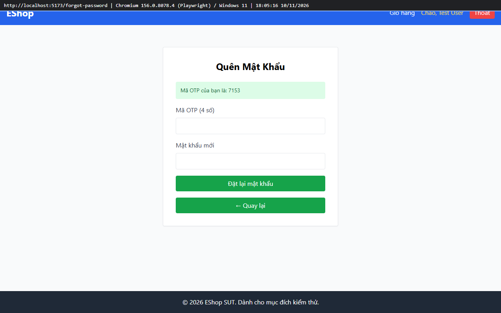
- **GitHub Issue:** _(chưa tạo)_

## BUG-20 – [Quên MK] Mật khẩu mới hợp lệ bị từ chối (cùng regex lỗi BUG-01) và backend chấp nhận mật khẩu yếu

- **Mức độ:** Cao
- **Mục checklist:** IA02-08, ADD-15
- **Bước tái hiện:** FE: nhập `Test1234!`. API: `POST /api/reset-password` newPassword `1`
- **Kỳ vọng:** FE chấp nhận mật khẩu mạnh; BE từ chối mật khẩu yếu (FR-03)
- **Thực tế:** FE từ chối `Test1234!`; BE trả "Password reset successfully" với `1`
- **Ảnh:** 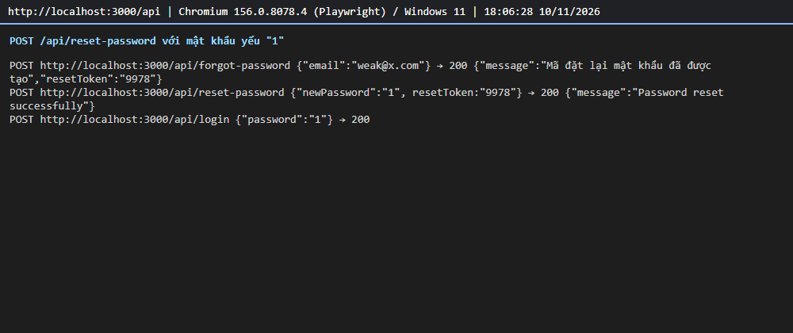
- **GitHub Issue:** _(chưa tạo)_

## BUG-21 – [Quên MK/API] Lộ việc email có tồn tại (user enumeration)

- **Mức độ:** Trung bình
- **Mục checklist:** IA04-08
- **Bước tái hiện:** Bước 1 nhập email không đăng ký
- **Kỳ vọng:** Phản hồi trung tính
- **Thực tế:** 404 "User not found"
- **Ảnh:** 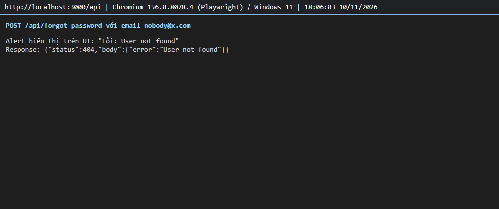
- **GitHub Issue:** _(chưa tạo)_

## BUG-22 – [Hồ sơ] Số điện thoại 0912345678 bị từ chối (regex sai)

- **Mức độ:** Cao
- **Mục checklist:** IA02-13, IA02-14, IA02-15
- **Bước tái hiện:** Đăng nhập → /profile → SĐT `0912345678` → Cập nhật
- **Kỳ vọng:** Chấp nhận: bắt đầu 0, 10–11 số (FR-04)
- **Thực tế:** Alert "Vui lòng nhập đúng 9-10 chữ số"; `912345678` (không có 0) lại được chấp nhận
- **Ảnh:**  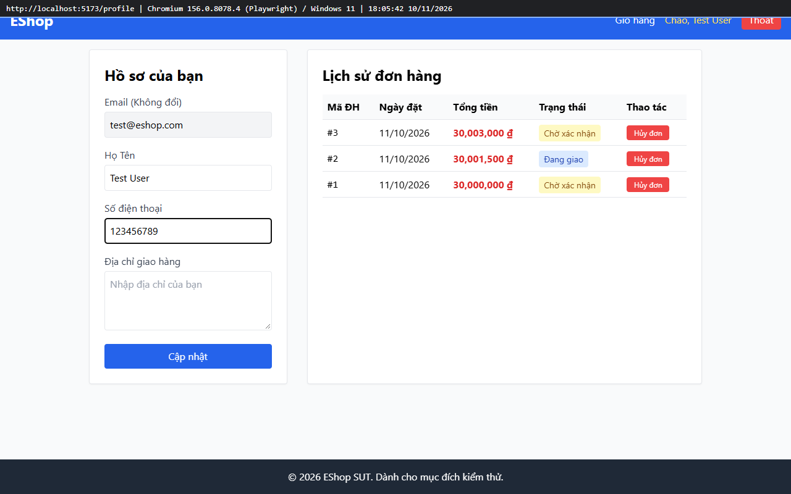
- **GitHub Issue:** _(chưa tạo)_

## BUG-23 – [Hồ sơ/API] User tự nâng quyền role=admin

- **Mức độ:** Rất cao
- **Mục checklist:** — (phát hiện qua API)
- **Bước tái hiện:** `PUT /api/users/me` kèm `"role":"admin"` với token user thường
- **Kỳ vọng:** Bỏ qua/Từ chối trường role (FR-04)
- **Thực tế:** 200 "Profile updated"; `GET /api/users/me` trả role=admin
- **Ảnh:** 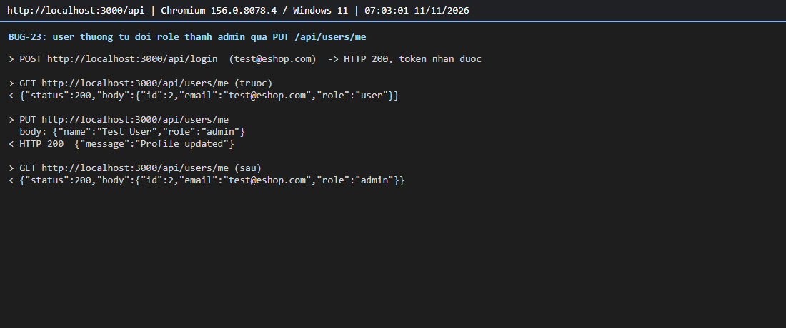
- **GitHub Issue:** _(chưa tạo)_

## BUG-24 – [Header/Hồ sơ] XSS qua Họ tên (dangerouslySetInnerHTML)

- **Mức độ:** Cao
- **Mục checklist:** ADD-13
- **Bước tái hiện:** Đổi Họ tên thành `` → Cập nhật → tải lại
- **Kỳ vọng:** Hiển thị chữ nguyên văn, không chạy script
- **Thực tế:** Script chạy (alert "xss" hiện ra)
- **Ảnh:** 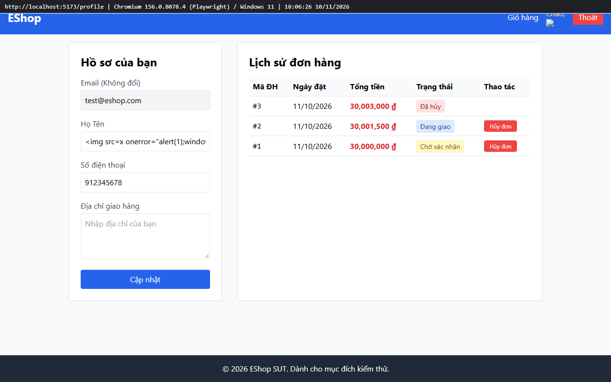
- **GitHub Issue:** _(chưa tạo)_

## BUG-25 – [Hồ sơ] Chưa đăng nhập: chỉ hiện chữ "Vui lòng đăng nhập", không chuyển hướng/không có link

- **Mức độ:** Thấp
- **Mục checklist:** IA03-07
- **Bước tái hiện:** Mở /profile khi chưa đăng nhập
- **Kỳ vọng:** Chuyển hướng /login hoặc có liên kết đăng nhập
- **Thực tế:** Chỉ có dòng chữ
- **Ảnh:** 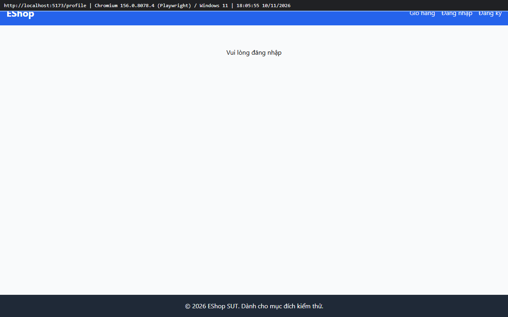
- **GitHub Issue:** _(chưa tạo)_

## BUG-26 – [Tất cả form] Không có trạng thái loading, nút không bị vô hiệu khi gửi

- **Mức độ:** Trung bình
- **Mục checklist:** IA02-20, IA04-07
- **Bước tái hiện:** Làm chậm API login 1.5s → bấm Sign In
- **Kỳ vọng:** Nút disabled/hiển thị đang xử lý, chống bấm đúp
- **Thực tế:** Nút vẫn bấm được (disabled=false)
- **Ảnh:** 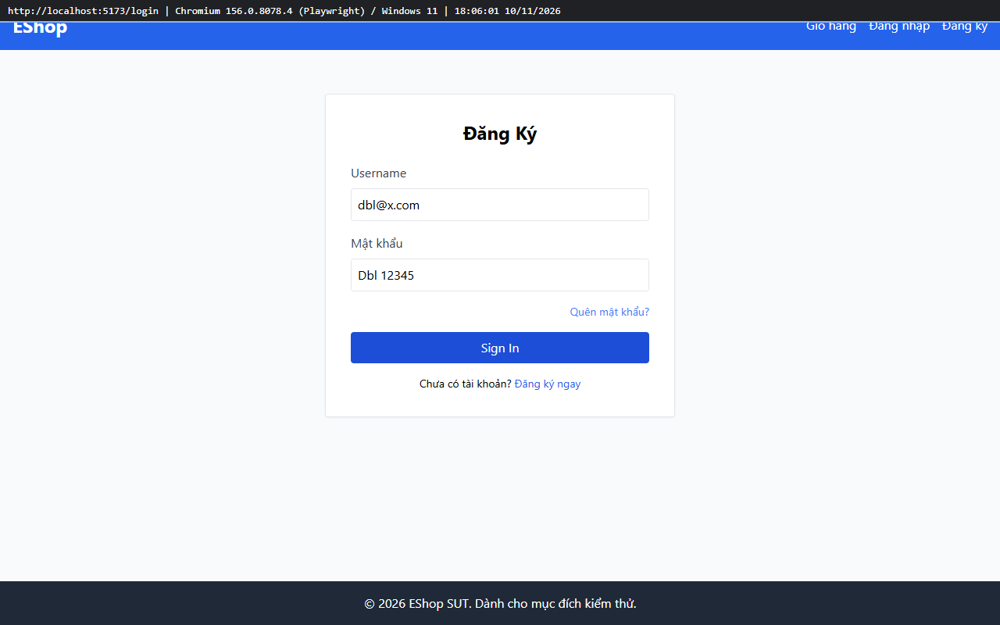 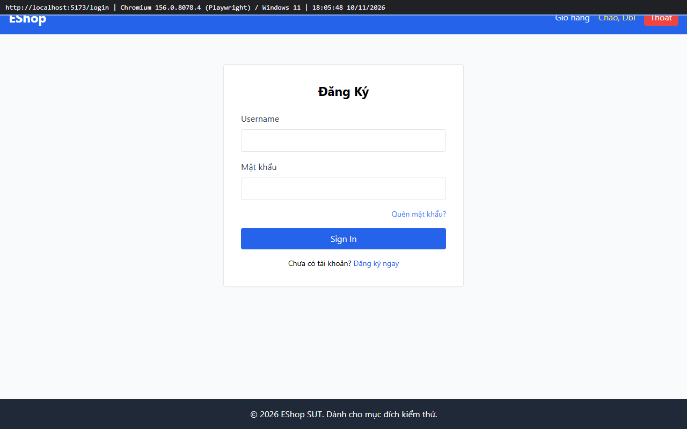
- **GitHub Issue:** _(chưa tạo)_

## BUG-27 – [Tất cả form] Nhãn không gắn với ô nhập (không có for/id/aria-label)

- **Mức độ:** Cao
- **Mục checklist:** IA02-01, ADD-01
- **Bước tái hiện:** Dùng DevTools/Accessibility tree trên 4 màn
- **Kỳ vọng:** Nhãn liên kết với input; bấm nhãn focus vào ô
- **Thực tế:** label=null trên toàn bộ input
- **Ảnh:** 
- **GitHub Issue:** _(chưa tạo)_

## BUG-28 – [Toàn site] <html lang="en">, title chung "frontend-web", không có <h1> ở các màn

- **Mức độ:** Trung bình
- **Mục checklist:** IA01-15, ADD-02, ADD-03, ADD-04
- **Bước tái hiện:** Xem DOM các màn
- **Kỳ vọng:** lang="vi"; title riêng từng trang; 1 h1 mỗi trang
- **Thực tế:** lang=en; title=frontend-web trên mọi trang; h1=0
- **Ảnh:**  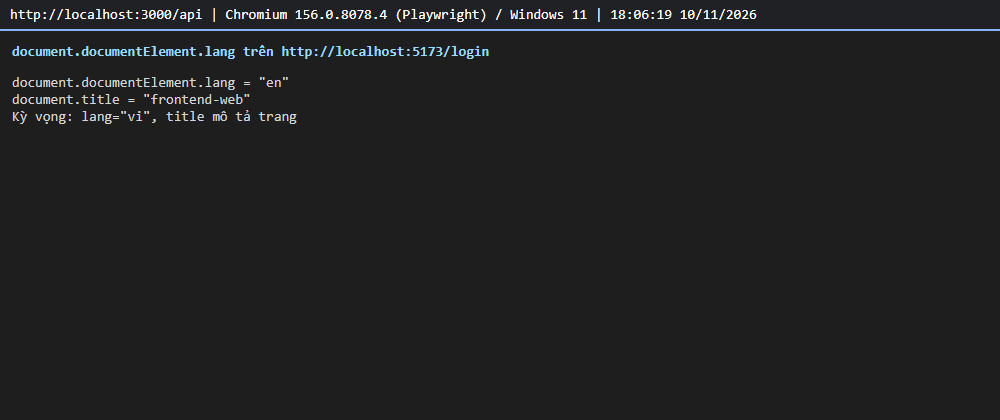 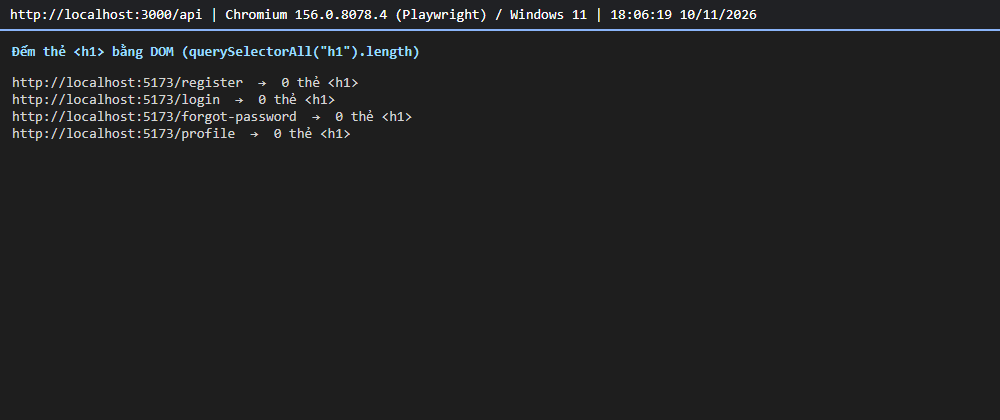
- **GitHub Issue:** _(chưa tạo)_

## BUG-29 – [Tất cả form] Lỗi không được thông báo cho trình đọc màn hình (không có aria-live/role=alert)

- **Mức độ:** Trung bình
- **Mục checklist:** ADD-11
- **Bước tái hiện:** Kiểm tra DOM khối lỗi đỏ/xanh
- **Kỳ vọng:** Vùng lỗi có role="alert" hoặc aria-live
- **Thực tế:** Không có vùng aria-live nào
- **Ảnh:** 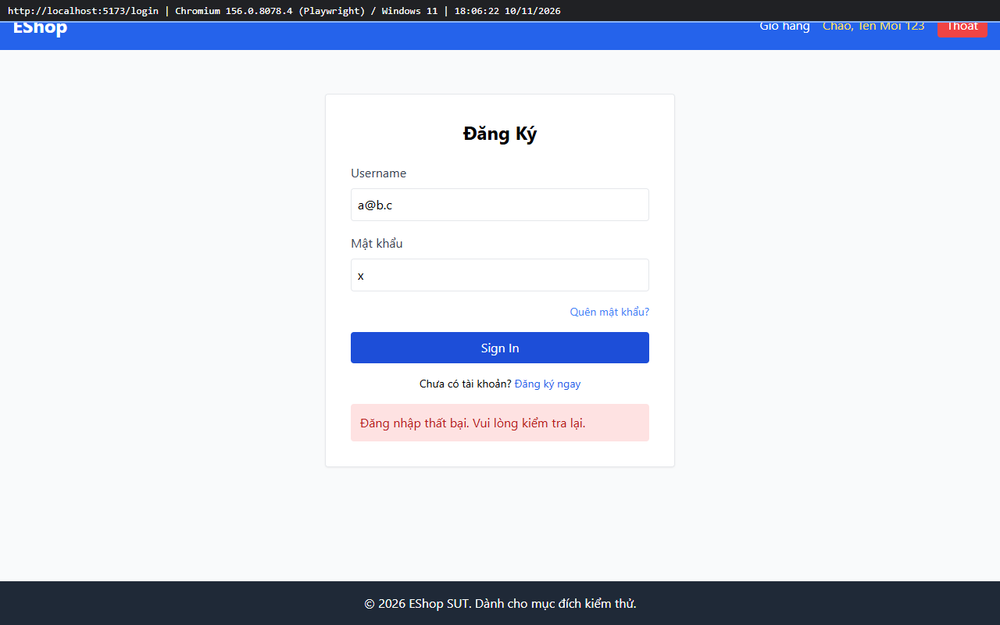
- **GitHub Issue:** _(chưa tạo)_

## BUG-30 – [Toàn site] Tương phản màu không đạt WCAG AA (hint 2.54:1, link xanh 3.68:1, nút đỏ 3.76:1, nút xanh lá 3.3:1)

- **Mức độ:** Trung bình
- **Mục checklist:** IA01-04, IA01-05, ADD-05
- **Bước tái hiện:** Đo bằng DevTools/axe
- **Kỳ vọng:** ≥ 4.5:1 cho chữ thường
- **Thực tế:** Dưới 4.5:1
- **Ảnh:** 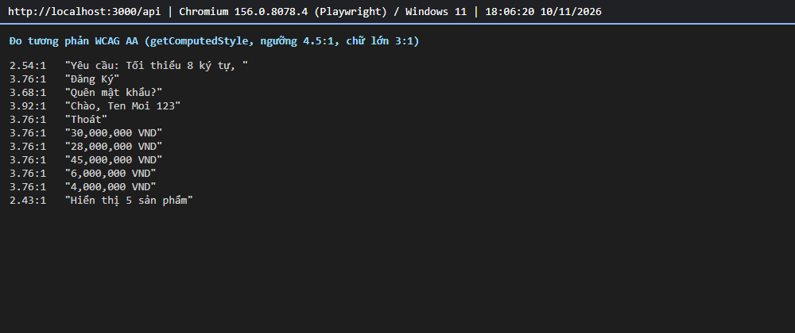 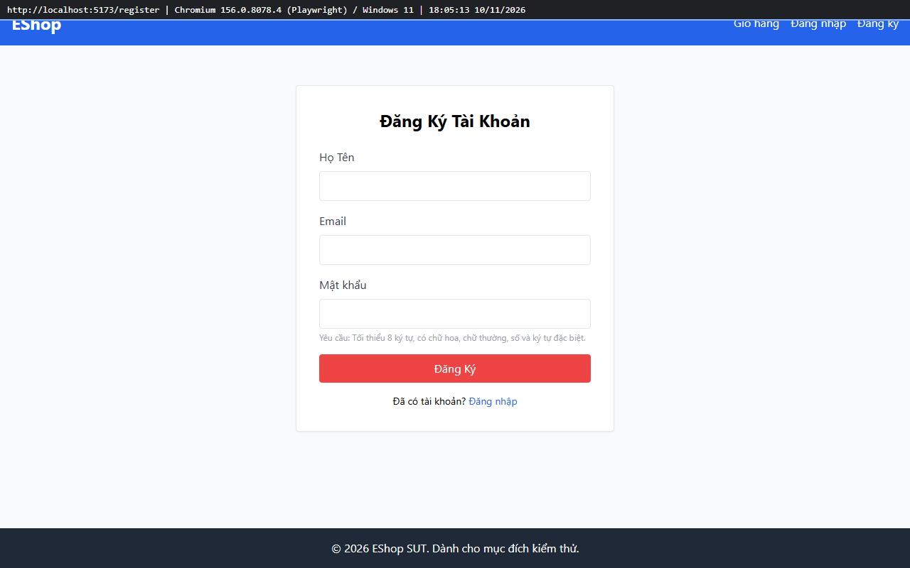
- **GitHub Issue:** _(chưa tạo)_

## BUG-31 – [Toàn site] Đường dẫn không tồn tại hiển thị trang trắng, không có 404

- **Mức độ:** Trung bình
- **Mục checklist:** ADD-12
- **Bước tái hiện:** Mở /khong-ton-tai
- **Kỳ vọng:** Trang 404 có link về trang chủ
- **Thực tế:** Vùng nội dung trống
- **Ảnh:** 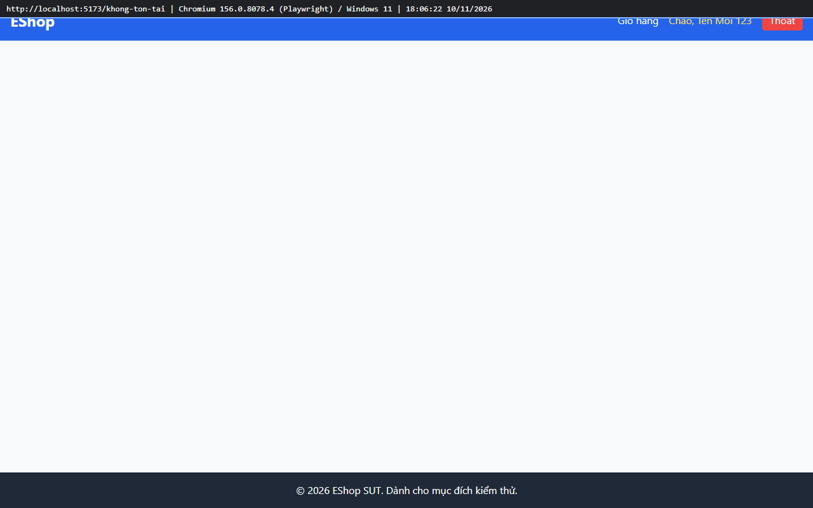
- **GitHub Issue:** _(chưa tạo)_

## BUG-32 – [Giao diện] Nút chính không nhất quán: Đăng ký màu đỏ, các màn khác màu xanh dương/xanh lá

- **Mức độ:** Thấp
- **Mục checklist:** IA01-07
- **Bước tái hiện:** So sánh 4 màn
- **Kỳ vọng:** Một kiểu nút chính xuyên suốt
- **Thực tế:** Register #ef4444, Login/Forgot-1 #2563eb, Forgot-2 #16a34a
- **Ảnh:** 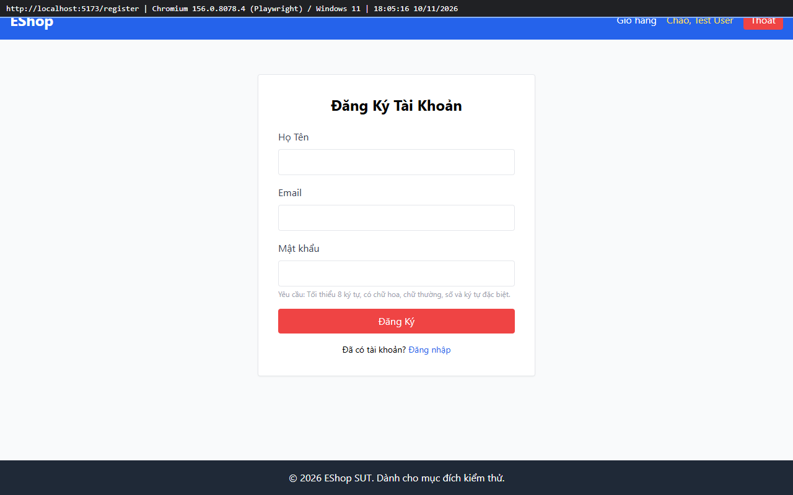
- **GitHub Issue:** _(chưa tạo)_

## BUG-33 – [Đăng ký] Đăng ký xong chuyển thẳng /login, không có thông báo thành công

- **Mức độ:** Thấp
- **Mục checklist:** IA03-05, IA04-01
- **Bước tái hiện:** Đăng ký với `Test 1234` (mật khẩu vượt được regex lỗi)
- **Kỳ vọng:** Hiện thông báo thành công
- **Thực tế:** Không có phản hồi nào
- **Ảnh:** 
- **GitHub Issue:** _(chưa tạo)_

## BUG-34 – [Form] Thiếu thuộc tính autocomplete (email, current-password, new-password) và không có nút hiện/ẩn mật khẩu

- **Mức độ:** Thấp
- **Mục checklist:** IA02-10, ADD-10
- **Bước tái hiện:** Kiểm tra DOM các ô nhập
- **Kỳ vọng:** autocomplete phù hợp; có nút hiện/ẩn mật khẩu
- **Thực tế:** autocomplete rỗng; không có toggle
- **Ảnh:** 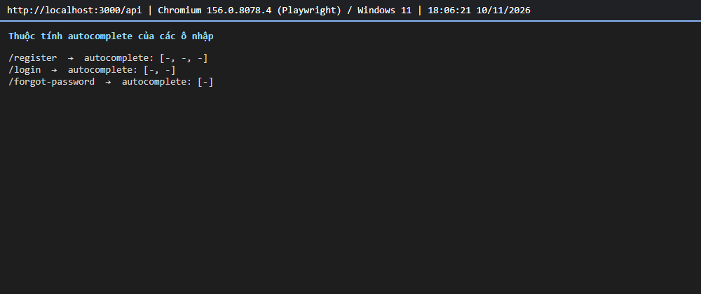
- **GitHub Issue:** _(chưa tạo)_

## BUG-35 – [Hồ sơ] Header không cập nhật họ tên sau khi sửa hồ sơ

- **Mức độ:** Trung bình
- **Mục checklist:** ADD-16
- **Bước tái hiện:** Đăng nhập test@eshop.com → /profile → đổi Họ tên thành "Ten Moi 123" → Cập nhật
- **Kỳ vọng:** Header đổi thành "Chào, Ten Moi 123" ngay sau khi cập nhật
- **Thực tế:** DB đã lưu tên mới, ô Họ tên hiện tên mới nhưng header vẫn "Chào, Test User"; phải đăng xuất rồi đăng nhập lại mới thấy
- **Ảnh:** 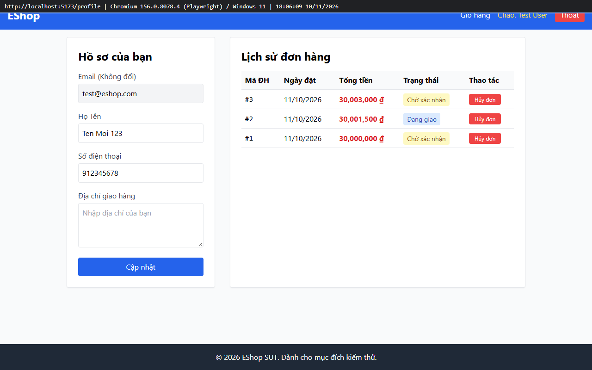
- **GitHub Issue:** _(chưa tạo)_

## BUG-36 – [Hồ sơ] Trang Hồ sơ cuộn ngang ở màn 375px (bảng đơn hàng tràn)

- **Mức độ:** Thấp
- **Mục checklist:** IA01-10, IA01-11
- **Bước tái hiện:** Mở /profile (đã đăng nhập, có đơn hàng) ở viewport 375×812
- **Kỳ vọng:** Không có cuộn ngang; bảng đơn hàng co lại hoặc cuộn trong khung riêng
- **Thực tế:** scrollWidth 397 > 375; bảng đơn rộng 356px làm cả trang cuộn ngang
- **Ảnh:**  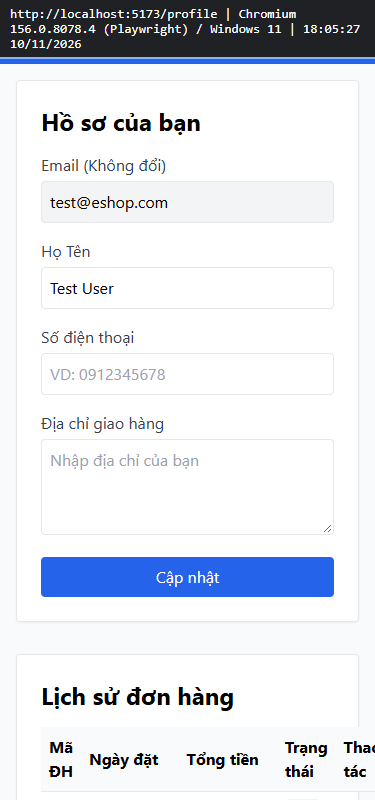
- **GitHub Issue:** _(chưa tạo)_

## BUG-37 – [Hồ sơ] Ngày và tiền trong lịch sử đơn không theo định dạng Việt Nam

- **Mức độ:** Thấp
- **Mục checklist:** IA01-14
- **Bước tái hiện:** Mở /profile trên trình duyệt locale en-US, xem dòng đơn hàng
- **Kỳ vọng:** Ngày dd/mm/yyyy, tiền dùng dấu chấm phân cách nghìn (vd 30.003.000 ₫)
- **Thực tế:** "11/10/2026" (m/d/yyyy), "30,003,000 ₫"; mã gọi toLocaleDateString()/toLocaleString() không chỉ định "vi-VN"
- **Ảnh:** 
- **GitHub Issue:** _(chưa tạo)_

## BUG-38 – [Đăng nhập/Đăng ký] Đã đăng nhập vẫn mở được /login và /register

- **Mức độ:** Thấp
- **Mục checklist:** IA03-08
- **Bước tái hiện:** Đăng nhập → gõ trực tiếp localhost:5173/login
- **Kỳ vọng:** Chuyển về trang chủ/hồ sơ hoặc báo "Bạn đã đăng nhập"
- **Thực tế:** Form đăng nhập vẫn hiện bình thường
- **Ảnh:** 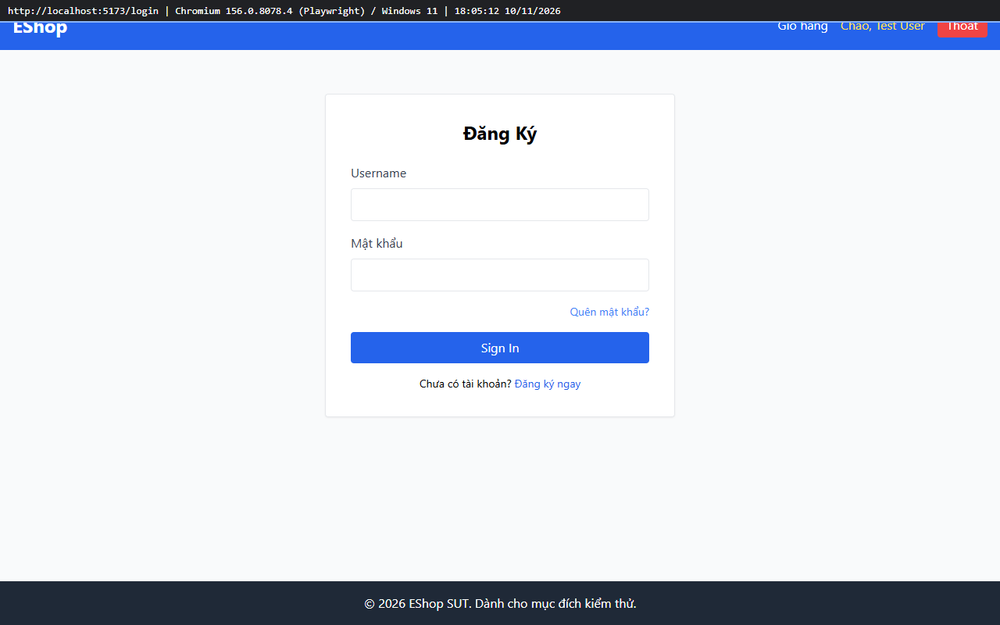
- **GitHub Issue:** _(chưa tạo)_

## BUG-39 – [Quên MK] Tải lại trang ở bước 2 mất trạng thái, quay về bước 1 mà không báo

- **Mức độ:** Thấp
- **Mục checklist:** IA03-10
- **Bước tái hiện:** /forgot-password → nhập email → Lấy mã OTP → F5
- **Kỳ vọng:** Giữ bước 2, hoặc báo rõ phải bắt đầu lại
- **Thực tế:** Về bước 1 trống, không thông báo; OTP cũ vẫn còn hiệu lực ở server
- **Ảnh:** 
- **GitHub Issue:** _(chưa tạo)_

## BUG-40 – [Hồ sơ] Nút "Hủy đơn" vẫn hiện với đơn đang giao và hủy không cần xác nhận

- **Mức độ:** Cao
- **Mục checklist:** IA04-14
- **Bước tái hiện:** Có đơn ở trạng thái "Đang giao" (shipping) → /profile → bấm Hủy đơn
- **Kỳ vọng:** Đơn đang giao không hủy được (FR-10); hành động hủy có hộp xác nhận
- **Thực tế:** Nút Hủy đơn hiện và bấm là hủy luôn, chỉ có alert "Hủy đơn thành công!". Ghi chú: thuộc FR-10/11 (ngoài phạm vi FR-01–04), báo lại cho bạn phụ trách
- **Ảnh:** 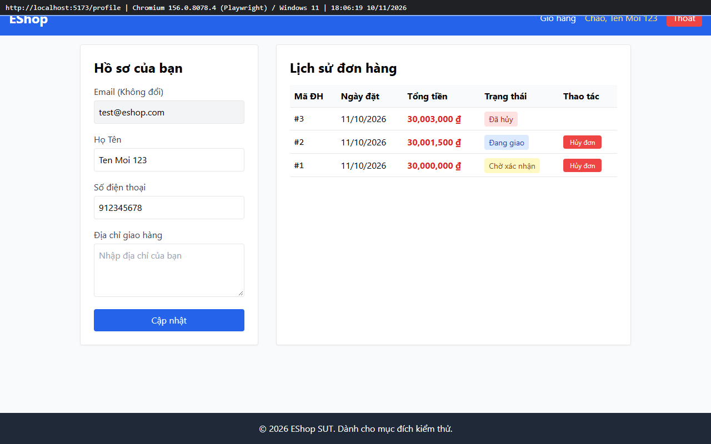
- **GitHub Issue:** _(chưa tạo)_

## BUG-41 – [Hồ sơ] Lịch sử đơn không có trạng thái đang tải

- **Mức độ:** Thấp
- **Mục checklist:** IA04-13
- **Bước tái hiện:** Làm chậm API /orders 1,5s → mở /profile
- **Kỳ vọng:** Hiện "Đang tải…" trong lúc chờ
- **Thực tế:** Hiện "Bạn chưa có đơn hàng nào." ngay cả khi dữ liệu chưa về
- **Ảnh:** 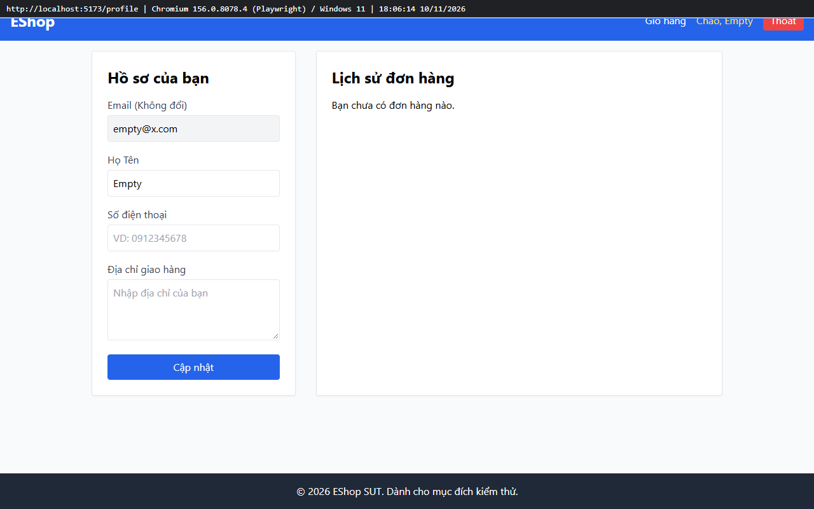
- **GitHub Issue:** _(chưa tạo)_

## BUG-42 – [Đăng ký/Hồ sơ] Họ tên không cắt khoảng trắng, không giới hạn độ dài

- **Mức độ:** Thấp
- **Mục checklist:** IA02-12
- **Bước tái hiện:** Nhập Họ tên 206 ký tự có khoảng trắng đầu/cuối → lưu
- **Kỳ vọng:** Cắt khoảng trắng, có giới hạn độ dài và báo lỗi khi vượt
- **Thực tế:** Lưu nguyên 206 ký tự kể cả khoảng trắng
- **Ảnh:** 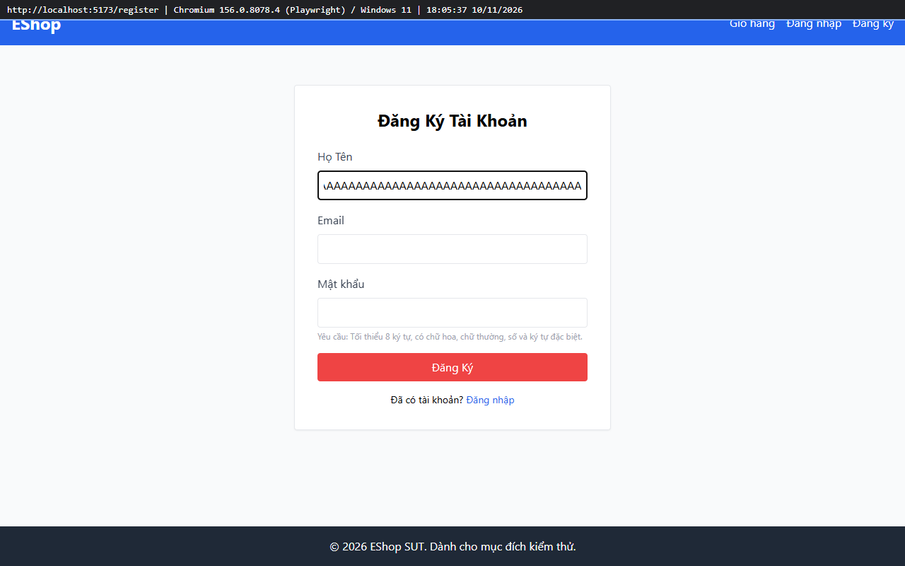
- **GitHub Issue:** _(chưa tạo)_

## BUG-43 – [Đăng ký] Không đánh dấu trường bắt buộc

- **Mức độ:** Thấp
- **Mục checklist:** IA02-02
- **Bước tái hiện:** Mở /register
- **Kỳ vọng:** Trường bắt buộc có dấu * hoặc chú thích "bắt buộc"
- **Thực tế:** Không có dấu hiệu, chỉ biết khi trình duyệt chặn lúc gửi
- **Ảnh:** 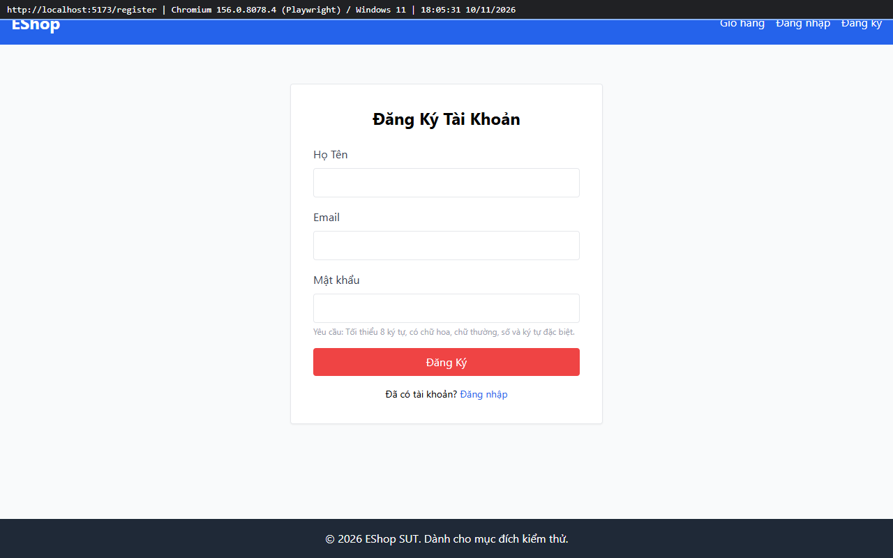
- **GitHub Issue:** _(chưa tạo)_

## BUG-44 – [Đăng ký] Thông báo lỗi mật khẩu không nêu điều kiện còn thiếu

- **Mức độ:** Thấp
- **Mục checklist:** IA02-07
- **Bước tái hiện:** /register → mật khẩu `abcd1234` → Đăng Ký
- **Kỳ vọng:** Báo cụ thể điều kiện thiếu (chữ hoa, ký tự đặc biệt), đặt cạnh ô mật khẩu
- **Thực tế:** Một câu chung "Mật khẩu quá yếu!…" ở đầu form
- **Ảnh:** 
- **GitHub Issue:** _(chưa tạo)_

## BUG-45 – [Giao diện] Khoảng cách và trạng thái hover không nhất quán giữa các màn

- **Mức độ:** Thấp
- **Mục checklist:** IA01-06, IA01-12
- **Bước tái hiện:** So sánh 4 màn: khoảng cách nhãn → ô nhập, hover nút chính
- **Kỳ vọng:** Cùng khoảng cách; nút chính đều đổi màu khi hover
- **Thực tế:** Hồ sơ 4px, 3 màn khác 8px; nút Quên MK và Hồ sơ không đổi màu khi hover
- **Ảnh:** 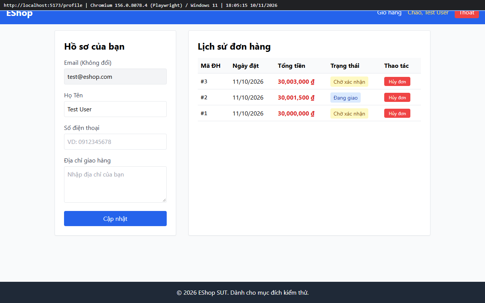 
- **GitHub Issue:** _(chưa tạo)_
